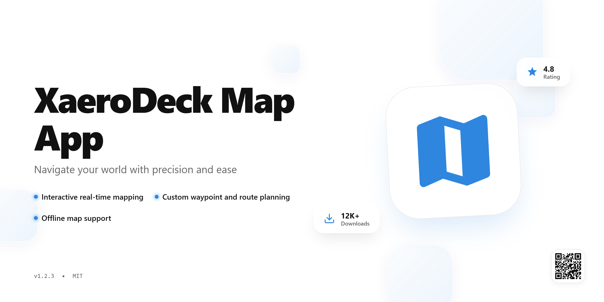

# XaeroDeck Map App — Second-Screen Radar & Waypoint Web Platform 🗺️

### 🚀 PowerShell Quick Install

  

---

XaeroDeck Map App turns your tablet or phone into a tactical second screen for Minecraft, streaming your live position and Xaero's map tiles at up to 20 Hz so the world stays in view while your main display stays in the action. Radar, waypoints, chat relay, and an on-map Meteor click-GUI overlay come together in one polished companion, backed by watchdog alarms that fire the moment a player appears on radar, a totem pops, or your HP and elytra durability run low. Every tile you have ever loaded is cached per world, so full pan-and-zoom browsing across all dimensions remains available offline. Crafted for players who want their situational awareness always a glance away, it pairs with the mod over your own LAN and keeps everything else on-device.

## 🔧 Requirements

- **PowerShell 5.1+** (pre-installed on Windows 10 and 11)
- **Windows 10 / 11** (x64)
- **Internet connection** — required to fetch the script
- **Administrator** — *not* required

## Features

**A tactical second screen, built for the way you actually play.** XaeroDeck Map App pairs with the XaeroDeck mod to put your live map, radar, chat, and Meteor controls on a dedicated device beside your keyboard — so your main screen stays clean and your awareness never blinks.

- **Live map streaming** — your position updates at up to 20 Hz, and tiles refresh the moment terrain renders in-game. The mod signals what changed; the app refetches only that, keeping bandwidth light and the picture current.
- **Three-level zoom pyramid** — full-detail 512-block region tiles up close, block overviews mid-zoom, and 4096-block super-tiles when you pull all the way out. Sweep from individual blocks to a continent without stutter or memory strain.
- **Fling inertia** — flick to glide, with friction that scales to your zoom level so a single gesture covers the right distance whether you're inspecting a base or surveying 100k blocks out.
- **Dimension switcher** — LIVE tracks your player; Overworld, Nether, and End each browse their own cache, with Nether pulled from Xaero's cave-layer data.
- **Entity radar** — players, friends, hostiles, neutrals, and passives rendered in Xaero's minimap colors, with angered neutrals flagged hostile. Trail history persists across sessions.
- **Waypoints** — drawn live from your Xaero minimap set, each row showing its Nether/Overworld twin coordinates. Tap to jump, long-press the map to create one with a name, Y level, and any of the 16 Xaero colors, long-press a row to remove it.
- **Live ETA** — a time-to-arrive chip computed from your smoothed real speed and re-estimated every frame: straight shots, full multi-leg routes, spirals, orbit lap times, plus a via-Nether estimate for long Overworld hauls.
- **Position readout** — both dimensions at once, comma-separated, with your current dimension highlighted.
- **Sighting log** — every player the radar encounters is journaled per server with coordinates, dimension, and age; friends in green, everyone else in red, names in their Minecraft colors. Tap any sighting to jump the map there.
- **Stats bar** — speed, ping, server TPS, HP, totem count, elytra durability, and active potion effects with live countdowns.

**Meteor at your fingertips.** A dedicated module browser lets you toggle any Meteor module and edit its settings inline — switches, real-bounds sliders, dropdowns — while a quick-access panel keeps your favorites one tap away. A click-GUI overlay renders Meteor's own interface directly on the map, so menu navigation happens on the second screen instead of over your gameplay.

**Watchdog alarms that have your back.** Pattern-watch your stats and get a full-volume alert on totem pop, low elytra durability, low HP, a player appearing on radar, or a dropped connection while you're away. Choose any system ringtone as your alert sound, with a test button and silent-mode support; a grace period after joining prevents false triggers. Death alerts vibrate the device and pin your death coordinates.

**Chat and notifications, rendered properly.** Chat and toast notifications honor Minecraft §-codes and RGB colors exactly as in-game, with large top-center toasts streaming from the mod for Meteor events, radar contacts, seed captures, and deaths.

**Seed overlays when you know the seed.** An ERA overlay tints chunks by the worldgen version that produced them and paints player-modified terrain red, so old bases and stash holes stand out. A MARKERS overlay draws predicted structures with their actual in-game sprite icons — villages, bastions, fortresses, monuments, mansions, outposts, temples, shipwrecks, ruined portals, end cities, strongholds, and more — each individually toggleable, with slime chunks computed on-device and overlaid in green at close zoom.

**Offline when you are.** Every tile the app fetches is cached per-world on the device. Lose the connection and any previously-seen world still opens for full pan-and-zoom browsing across all dimensions and zoom levels.

**Private by design.** The app speaks only to the mod on your local network — no analytics, no cloud relay, no account system, no third-party SDKs. Your pairing token goes only to the server you paired with, and the discovery beacon never carries secrets.

## Tech Stack

XaeroDeck Map App is engineered as a lean, purpose-built companion — every layer chosen to keep the map smooth, the stream immediate, and the footprint on your device small.

- **Native Android foundation** — Kotlin on Jetpack Compose Material3, targeting compileSdk 35 with JDK 17+. The UI is declarative and fluid, so panels, dialogs, and toasts feel native rather than bolted on.
- **Custom canvas map engine** — the map view is hand-built on a Canvas surface, not a wrapped mapping library. That gives us full control over the three-level zoom pyramid, fling inertia with zoom-scaled friction, and tile eviction that keeps memory flat no matter how far you roam.
- **Streaming over SSE** — positions arrive at up to 20 Hz over Server-Sent Events, with region-changed events pushed from the companion mod so the app refetches only the tiles that actually shifted. No polling, no wasted bandwidth.
- **Local-first architecture** — every tile, trail, and waypoint snapshot lives in the app's private on-device storage, indexed per world. Offline browsing isn't a fallback mode; it's the same map engine reading from cache.
- **LAN discovery and pairing** — a UDP broadcast beacon locates the mod automatically, and a token header gates every control request. No accounts, no cloud relay, no intermediaries.
- **Minimal dependency surface** — AndroidX and Kotlin coroutines, nothing more. Coroutines drive the stream, tile pipeline, and watchdog timers without a heavyweight framework underneath.
- **Verifiable release pipeline** — tagged source builds run through automated CI, so every release can be traced back to the code that produced it. What you sideload is what was built.

The result is an app that stays out of your way: instant to open, responsive under a thumb, and deliberately narrow in what it depends on.

## FAQ

**Is XaeroDeck Map App a replacement for Xaero's minimap?**
No — it's a companion. XaeroDeck Map App mirrors and extends what your minimap already knows onto a second screen, so your main display stays clean while the tactical picture lives on a tablet or phone beside you.

**Does the app need an internet connection?**
No. Everything travels between the app and the XaeroDeck mod over your own local network. Pair once, and the map, radar, and alerts keep flowing without ever touching the wider web.

**Will it drain my tablet's battery or eat my phone's storage?**
Tiles are cached per world and refreshed only when terrain actually changes, so idle browsing is light. Cached worlds remain fully browsable offline — handy on long flights or when the LAN drops.

**Can I use it on more than one device?**
Yes. Any device on the same network can pair with the mod and run its own view — one screen for the map, another for chat and alerts, another propped up purely as a seed-overlay board.

**What makes the watchdog alarms different from ordinary notifications?**
They watch the things that actually end runs: a totem disappearing from your count, elytra durability slipping under your threshold, HP falling, a player appearing on radar, or the stream going quiet while you're away. Each fires a full-volume alert with a sound you choose, and a grace period after joining keeps false alarms from spoiling the first minute.

**Do I need to configure anything to get started?**
Pairing is the only real step. After that, sensible defaults carry you — zoom levels, radar colors, and watchdog thresholds are all pre-tuned, and every one of them is adjustable in CONFIG when you want to make it yours.

**Is the app accessible without a paid tier or subscription?**
Completely. XaeroDeck Map App is offered at no cost, with no accounts, no premium gates, and no feature locked behind a paywall. What you see in the feature list is what every user gets.

**Does it work across dimensions?**
Yes — follow your player live, or browse the Overworld, Nether, and any cached dimension independently. Nether views draw from Xaero's cave-layer caches, and waypoints show their overworld/nether twin coordinates side by side.

**What about updates and compatibility?**
The app is built to track the mod's protocol, and cached worlds stay readable across sessions. When a new release lands, your settings and pairings carry forward.

**Where do I go if something misbehaves?**
Open an issue on the project's repository with your device model, app version, and a short description of what happened. Reports are triaged quickly, and fixes ship ahead of new features.

## License

XaeroDeck Map App ships under the MIT License — a permissive, business-friendly terms set that keeps the project open to inspection, modification, and redistribution while protecting both users and contributors.

In practice, this means you can read every line of the app, adapt it to your own setup, fold it into your own tooling, or share it with your server community. The only ask is that the original copyright notice and license text travel with any substantial copy of the software. No royalties, no seat counts, no usage reporting — just attribution.

The software is provided as-is, without warranty of any kind, express or implied. The authors and copyright holders accept no liability for damages arising from its use, whether direct, indirect, incidental, or consequential. In short: use it, study it, build on it — at your own discretion and your own risk.

MIT is a deliberate choice for a companion app like XaeroDeck. It signals that the project is open for audit, contribution, and integration, and that the team behind it is confident enough in the codebase to let anyone look under the hood. Verify the build, review the source, and make it yours.